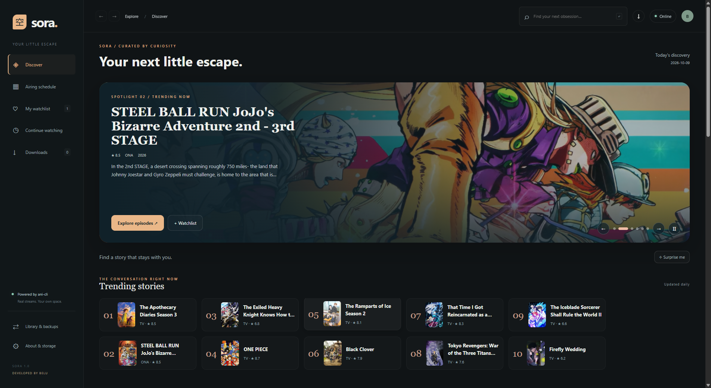

# Sora

Your next little escape. An artwork-first anime desktop app for **Windows and Linux**, developed by **Belu**.

**Built using the original [pystardust/ani-cli](https://github.com/pystardust/ani-cli).** Sora provides a custom Electron interface and built-in player around ani-cli's search, episode listing, and stream resolution functions. Those functions come from the original, unmodified upstream script—not an independently written streaming engine. This is an independent project and is not an official ani-cli release.



## Features

- AniList artwork, daily discovery, relationships, and airing schedule.
- Built-in player with fullscreen, quality selection, playback speed, and subtitle settings.
- Episode downloads with pause/resume, cancellation, and destination selection.
- Offline playback and saved or imported subtitles in the same player.
- Watchlist, resume history, total watch time, and portable library backups.
- Your own username and profile initial, with a first-launch prompt and editable local profile.

## Install

See the **[complete installation guide](docs/INSTALL.md)** for prerequisites, Windows and Linux steps, other devices, updates, backups, troubleshooting, and uninstalling. Sora runs from source; Android/iOS are not supported. macOS is experimental.

### Windows 10/11 (64-bit)

1. Install **[Node.js 24+](https://nodejs.org/en/download)** with npm and **[Git for Windows](https://git-scm.com/downloads/win)** with Git Bash. Reopen PowerShell after installation.
2. Download a Windows FFmpeg build through **[FFmpeg's download page](https://ffmpeg.org/download.html)**, extract it, and locate its `bin` directory containing `ffmpeg.exe`. Add that directory to PATH, or set `SORA_FFMPEG_DIR` before launching Sora (example below). FFmpeg is used for download processing.
3. Check that Node and Git are available:

```powershell
node --version
npm.cmd --version
git --version
```

Node must report **v24 or newer**. Clone into a writable folder, for example Documents:

```powershell
cd ([Environment]::GetFolderPath('MyDocuments'))
New-Item -ItemType Directory -Force MADEWITHGPT | Out-Null
cd MADEWITHGPT
git clone https://github.com/janidutm/Sora.git
cd Sora
powershell -NoProfile -ExecutionPolicy Bypass -File .\Setup.ps1
npm.cmd start
```

If FFmpeg is not on PATH, set its actual extracted folder **before** `npm.cmd start`:

```powershell
$env:SORA_FFMPEG_DIR = 'C:\Tools\ffmpeg\bin'
npm.cmd start
```

Replace that example path with yours. Sora also detects `%USERPROFILE%\ffmpeg\bin`. Git Bash is normally found at `C:\Program Files\Git\bin\bash.exe`; custom installations can set `$env:SORA_BASH = 'D:\Apps\Git\bin\bash.exe'`.

Review `Setup.ps1` before running it. It downloads the pinned original ani-cli script/license and yt-dlp, installs locked npm dependencies, and explicitly downloads Electron. It does not install system prerequisites or change PATH. The PowerShell execution-policy override applies only to the setup process.

**Open later:** double-click **Start Sora.cmd** in the installed folder, or open PowerShell there and run `npm.cmd start`. Environment variables set in PowerShell last for that shell; if relying on a custom tool path, launch from that shell or configure the variable persistently through Windows settings.

### Linux desktop (Ubuntu / Debian)

Install prerequisites:

```bash
sudo apt update
sudo apt install git curl bash python3 ffmpeg libgtk-3-0 libnss3 libgbm1 libasound2t64
```

Older distributions may call the last package `libasound2`. Install **Node.js 24+ with npm** using [the official Node.js instructions](https://nodejs.org/en/download); your distribution's default Node package may be older. Verify with `node --version` and `npm --version`.

Then, as your regular user:

```bash
mkdir -p ~/Applications
cd ~/Applications
git clone https://github.com/janidutm/Sora.git
cd Sora
bash setup.sh
npm start
```

Setup downloads the original pinned ani-cli script/license, Python-based yt-dlp, npm dependencies, and Linux Electron. It needs Python 3 and internet access. It does not use sudo or change your shell configuration.

**Open later:** run `bash start-sora.sh` or `npm start` inside the Sora folder. Keep Node/npm visible to the launching shell. Use a graphical desktop and a writable folder; do not run Sora as root. WSL requires WSLg or another display server and its own Linux dependency installation.

For Fedora, Arch, ARM64, experimental macOS, and Chromebook guidance, see [the full device guide](docs/INSTALL.md). Android/iOS are not supported. Native ARM64 hardware and macOS are untested.

### First launch and your profile

Sora asks **“What should we call you?”** on first launch. Enter a username of up to 32 characters; the profile button shows your initial instead of the developer's initial. Click that button anytime to edit your name. Choosing **Later** keeps a neutral `?` and asks again next launch.

This is a local display name, not an online account. No password or registration is required. The name is saved locally and included in exported library backups. **Belu** remains the developer credit, independently of your profile.

### Updating, backups, and removal

Close Sora, export your library through **Library & backups**, and copy downloaded videos separately. Then update from the installed folder:

```bash
git pull --ff-only
```

Rerun `Setup.ps1` on Windows or `bash setup.sh` on Linux, then launch normally. Do not copy `node_modules` between operating systems. Setup preserves existing vendor/tool files.

Application data lives in `data/`; downloads default to `downloads/`. Both are excluded from Git. Change the download destination in Downloads. Library backups include your username, watchlist, history, watch time, and preferences; they exclude video files and the download queue.

On Windows, preview removal with `powershell -NoProfile -ExecutionPolicy Bypass -File .\Uninstall.ps1 -WhatIf`. The uninstall script removes the installed folder and its data/downloads; `-KeepDownloads` keeps default downloads separately. On Linux, close Sora, back up anything you want to keep, and delete the exact cloned folder using your file manager. System prerequisites remain installed.

### Troubleshooting

- **Missing tool:** rerun setup and check Bash/FFmpeg. Overrides: `SORA_BASH`, `SORA_FFMPEG_DIR`, `SORA_YTDLP`, and optional `SORA_MPV`.
- **Electron missing:** rerun setup; it explicitly runs Electron's binary installer after `npm ci`.
- **Linux shared-library/sandbox error:** follow [the Linux troubleshooting guide](docs/INSTALL.md#troubleshooting). Keep the sandbox enabled and use a supported graphical desktop.
- **An episode fails or lacks subtitles/quality:** retry or choose another audio edition; availability depends on the upstream source. Offline captions can be repaired with **Fetch subtitles** or supplied using **Add subtitles**.
- **mpv is missing:** it is optional. The built-in player is the default; install mpv separately and set `SORA_MPV` only if you want the external fallback.

See [the user guide](READ%20ME.md), [download controls](docs/release-1.1.md), and [offline playback](docs/offline-playback.md) for using the app.

## Original ani-cli attribution

- Original project: **[pystardust/ani-cli](https://github.com/pystardust/ani-cli)**, by its upstream authors and contributors.
- Pinned upstream revision: [`21ed4a0a6354688622b5a967d93ba96d851d0ef2`](https://github.com/pystardust/ani-cli/tree/21ed4a0a6354688622b5a967d93ba96d851d0ef2), version 5.1.5.
- [`bridge.sh`](bridge.sh) loads upstream functions without launching the terminal interface. Setup places the unmodified script and upstream license in `vendor/ani-cli/`.
- Sora application code is **GPL-3.0-or-later**; see [LICENSE](LICENSE). Preserve upstream copyright and license notices when redistributing.
- Artwork and metadata come from [AniList](https://anilist.co/) and their respective rights holders. Electron, HLS.js, yt-dlp, FFmpeg, and optional mpv retain their own licenses.

## Development and verification

```powershell
npm.cmd test
npm.cmd start
```

Version 1.2.1 has 36 passing tests on Windows, including username validation and backup compatibility. Its Electron profile checks cover the first-launch prompt, editing, validation, safe display, and persistence after reload. The 1.2.0 Linux baseline passed 34 tests and offline-player integration checks in Ubuntu (WSL). Integration scripts under `tests/` use isolated fixture data and may require additional local fixtures. External sources can change; these checks do not guarantee every title or source will work.

Linux runtime and test details are recorded in [Linux verification](docs/linux-verification.md).
